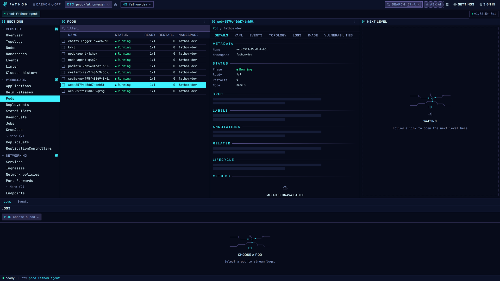
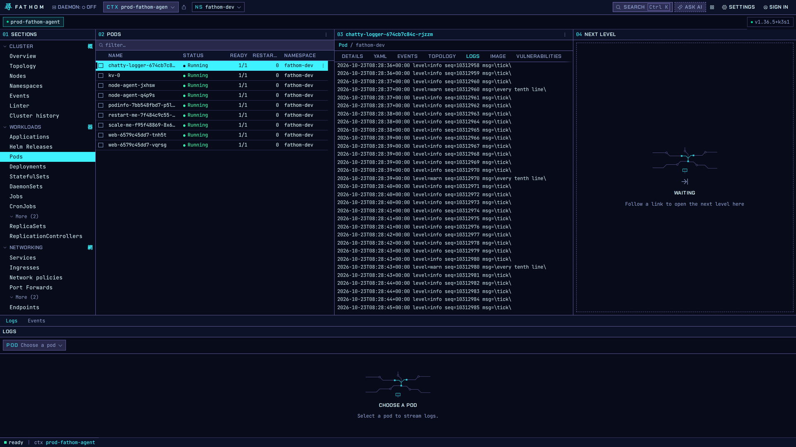
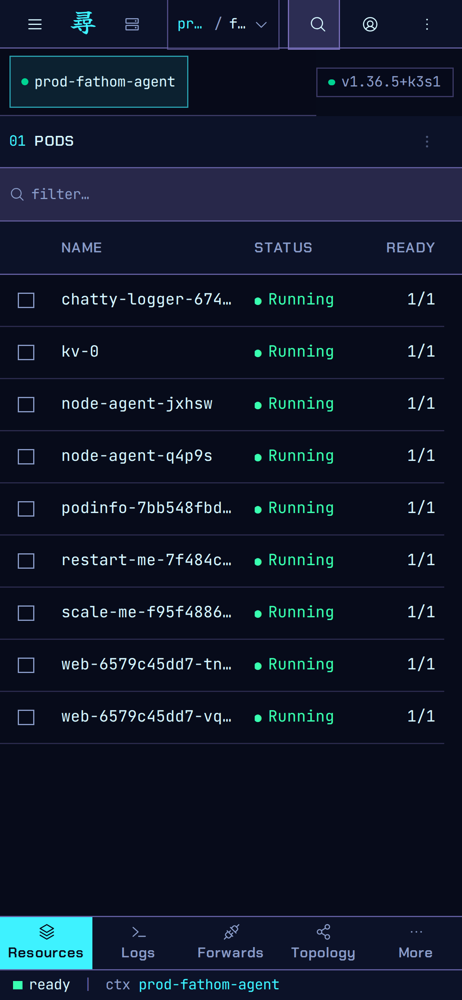

# Fathom and Depths

> Orchestration companions for people who run their own infrastructure: fast, dense UIs that show you
> what is really there and confirm every change.


This repository holds two apps that share a look, a set of libraries and a way of working. Each one
manages a different kind of host. Both read your real state rather than a copy of it, preview what a
change will do before doing it, and record who did what.

| App | For | Runs as | Get it |
|---|---|---|---|
| **[Fathom](#fathom)** | Kubernetes clusters | A desktop app (Linux), or hosted in a cluster for a team | [Install Fathom](#installing-fathom) · [Guides](docs/guides/README.md#fathom) |
| **[Depths](#depths)** | Docker and Docker Compose hosts | One container beside the stacks it manages | [Install Depths](docs/guides/depths/install.md) · [Guides](docs/guides/depths/README.md) |

Use Fathom when your workloads run on Kubernetes. Use Depths for a machine that runs Compose stacks,
for example one you manage with Dockge today.

---

## Fathom

### What it is

Fathom is a desktop Kubernetes dashboard built with a Rust backend and a [Tauri](https://tauri.app) + React UI. It gives platform engineers and operators a dense, responsive UI for navigating and managing Kubernetes clusters — without the sluggishness of web-based tools or the context-switching of raw `kubectl`.

**Goals:**
- Single-pane observability: nodes, workloads, network, storage, access control, events — all in one app
- Real Prometheus metrics, not just resource requests/limits
- Port-forwarding, log streaming, scaling, and restarts without leaving the UI
- MCP (Model Context Protocol) server for AI-agent integration
- Sub-200ms UI interactions, even on large clusters

**Non-goals:**
- Abstractions that hide Kubernetes objects (guided setup paths are fine — they show every artifact and confirm every write)
- Multi-cloud abstractions
- Replacing `kubectl` for one-off operations

---

### Screenshots



| Applications | Logs | Phone |
|---|---|---|
|  |  |  |

New to Fathom? Start with the [Fathom guides](docs/guides/README.md#fathom).

---

### Installing Fathom

#### Pre-built bundles

Download the latest release from the [Releases page](https://github.com/mbround18/fathom/releases).
Assets, as the Tauri bundler names them (Linux x86_64 is the validated MVP target):

| Bundle | Asset |
|---|---|
| Debian / Ubuntu | `Fathom_<version>_amd64.deb` |
| Fedora / RHEL | `Fathom-<version>-1.x86_64.rpm` |
| Any distro | `Fathom_<version>_amd64.AppImage` |
| Windows (experimental, untested) | `Fathom_<version>_x64-setup.exe` |

Packages are **not code-signed**, but every asset built by GitHub Actions carries a Sigstore
provenance attestation. Check it before you install (see
[Verifying a download](docs/guides/verifying-downloads.md)):

```sh
gh attestation verify Fathom_<version>_x64-setup.exe --repo mbround18/fathom
```

macOS (`.dmg`) bundles, Authenticode signing and notarization are planned for after the MVP;
aarch64 Linux packages wait until someone has tested them.

#### Build from source

Prerequisites:

| Tool | Version | Notes |
|---|---|---|
| Rust | 1.99.0 | pinned in `rust-toolchain.toml`; rustup picks it up |
| Node | LTS (22+) | |
| pnpm | 9+ | `corepack enable` |
| Linux system libs | webkit2gtk-4.1 | see below |

```bash
# Ubuntu/Debian
sudo apt install libwebkit2gtk-4.1-dev build-essential curl wget file libxdo-dev \
  libssl-dev libayatana-appindicator3-dev librsvg2-dev

git clone https://github.com/mbround18/fathom
cd fathom
pnpm -C ui install

make build-linux            # deb + rpm + AppImage + the binary, all into ./dist
make                        # the full target list (build-windows and build-macos exist but are post-MVP, untested)
make build-windows-paws     # Windows NSIS installer, cross-built in a container via paws (scripts/build-windows.sh)
```

Each target stages into `./dist` beside a regenerated `SHA256SUMS`; the underlying
`pnpm -C ui tauri build` leaves its output under the cargo target dir instead. Bundles
built this way are **unsigned** — signing and notarization are post-MVP.
Third-party licences are listed in `THIRD_PARTY_LICENSES.md`.


#### Hosted server mode (in-cluster, browser)

Fathom also runs as a web service inside a cluster: people sign in through your OIDC provider
(Keycloak, Rauthy, Dex, Entra ID, Okta...) and every Kubernetes request is made as the signed-in
person, so cluster RBAC decides what each of them sees. Mutations are recorded in an attributed,
append-only audit log.

```bash
helm install fathom deploy/helm/fathom -n fathom --create-namespace \
  --set externalUrl=https://fathom.example.com \
  --set oidc.issuer=https://idp.example.com/realms/ops --set oidc.clientId=fathom
```

See [docs/HOSTED.md](docs/HOSTED.md) for provider claim mappings, the impersonation model for
managed clusters, ingress/WebSocket notes and the audit log.

---

### Requirements

- A `~/.kube/config` (or `KUBECONFIG` env var) pointing to a reachable cluster
- Kubernetes 1.25+
- RBAC: `get`/`list`/`watch` on the resources you want to view; `update`/`patch` for mutations

---

### Features

#### Navigation

- Left-hand tree navigation: Overview · Nodes · Workloads · Network · Storage · Config · Access Control · Events
- Global namespace filter (top bar) — filters all views simultaneously
- Clickable cross-links between resources (pod → workload, namespace label → filter)

#### Workloads

| Resource | List | Details | Scale | Restart | Delete | Metrics |
|---|---|---|---|---|---|---|
| Pods | ✅ | ✅ | — | — | ✅ | ✅ |
| Deployments | ✅ | ✅ | ✅ | ✅ | ✅ | ✅ |
| DaemonSets | ✅ | ✅ | — | ✅ | ✅ | ✅ |
| StatefulSets | ✅ | ✅ | ✅ | ✅ | ✅ | ✅ |
| ReplicaSets | ✅ | ✅ | ✅ | ✅ | ✅ | — |
| Jobs | ✅ | ✅ | — | — | ✅ | — |
| CronJobs | ✅ | ✅ | — | — | ✅ | — |

#### Network

- Services, Endpoints, Ingresses, IngressClasses, NetworkPolicies
- **Port Forwards**: create, list, stop, persist across sessions

#### Storage

- PersistentVolumes, PersistentVolumeClaims, StorageClasses
- Disk usage via Longhorn or Prometheus integration

#### Config & Access Control

- ConfigMaps, Secrets (value masking), ResourceQuotas, LimitRanges
- Roles, RoleBindings, ClusterRoles, ClusterRoleBindings

#### Observability

- **Cluster Events**: real-time warning and normal events
- **Pod Logs**: real-time streaming, container selection, pause/resume
- **Metrics** (requires Prometheus or metrics-server):
  - Node CPU/memory
  - Pod CPU/memory (per-container breakdown)
  - Workload aggregate CPU/memory

#### Integrations

##### Prometheus

Fathom auto-discovers Prometheus in your cluster or can be configured manually:

```
Integrations → Metrics → Prometheus
  Namespace: monitoring
  Service:   prometheus-operated
  Port:      9090
```

With Prometheus configured, workload details panels show CPU/memory graphs with real data.

##### Grafana

Link Fathom to your Grafana instance for dashboard deep-links:

```
Integrations → Grafana
  Base URL: https://grafana.example.com
  API Key:  <your API key>
```

##### MCP (Model Context Protocol)

Fathom ships a stdio MCP server (`src/backend/mcp/`) for same-machine AI agents such as Claude
Code or Claude Desktop. It is **off by default** and has no network listener; enable it from the
app or run it headless:

```
Integrations → MCP → enable          # in the app
cargo run -p fathom-desktop -- --only-mcp   # headless, stdio only
```

Read tools: get and list objects, events, a pod log tail, and a pod health summary. Mutating tools
(scale, replace, delete) ask the agent to confirm with you first and pass the same RBAC check as
the UI. The MCP server is experimental in 0.1.0.

---

### Configuration

Fathom keeps its configuration under `~/.fathom/` (per-context settings, fleet metadata, the
local mutation audit log). Secrets such as Grafana API keys live in the OS keyring, not on disk.

---

## Depths

Depths manages the Docker Compose stacks on one host from a browser. It reads a directory of stacks
(one sub-directory per stack, the layout Dockge uses), shows what is running, and lets the people
you admit start, stop, update and edit their stacks, follow logs, watch stats and open shells, in
tabs side by side.

- **Sign in with OIDC, GitHub or Discord.** No shared password and no anonymous mode. New people
  wait until an admin lets them in, and a user only sees the stacks assigned to them.
- **Preview, then act.** Every change shows the exact `docker compose` command first, and lands in
  an audit log with who ran it and from where.
- **Compatible with Dockge.** Point it at Dockge's stacks directory and try it side by side; it
  saves files exactly as typed and never touches Dockge's own data.
- **One container**, behind a Docker socket proxy and your reverse proxy.

<!-- T086: replace with Depths screenshots in docs/guides/images/. -->
_Depths screenshots are on the way._

### Installing Depths

There is no published image yet; build it from this repository, then run the example compose file:

```sh
make depths-image                      # builds depths:dev
cp apps/depths/.env.example .env       # next to a copy of apps/depths/compose.yaml
docker compose up -d
```

Docker access is root on the host, so read [Installing Depths](docs/guides/depths/install.md)
before you run it: it covers the socket proxy, the reverse proxy and every setting. Then set up a
[sign-in provider](docs/guides/depths/sign-in.md) and [let people in](docs/guides/depths/users.md).
Coming from Dockge? See [Migrating from Dockge](docs/guides/depths/migrating-from-dockge.md).

---

## Guides

Everything a user needs to learn is in [docs/guides](docs/guides/README.md): the
[Fathom guides](docs/guides/README.md#fathom) and the [Depths guides](docs/guides/depths/README.md).

## Development

Building, testing, the workspace layout and the release process are in
[CONTRIBUTING.md](CONTRIBUTING.md). PRs welcome.

## License

Apache-2.0 — see [LICENSE](LICENSE). Third-party licences are listed in
[THIRD_PARTY_LICENSES.md](THIRD_PARTY_LICENSES.md).
