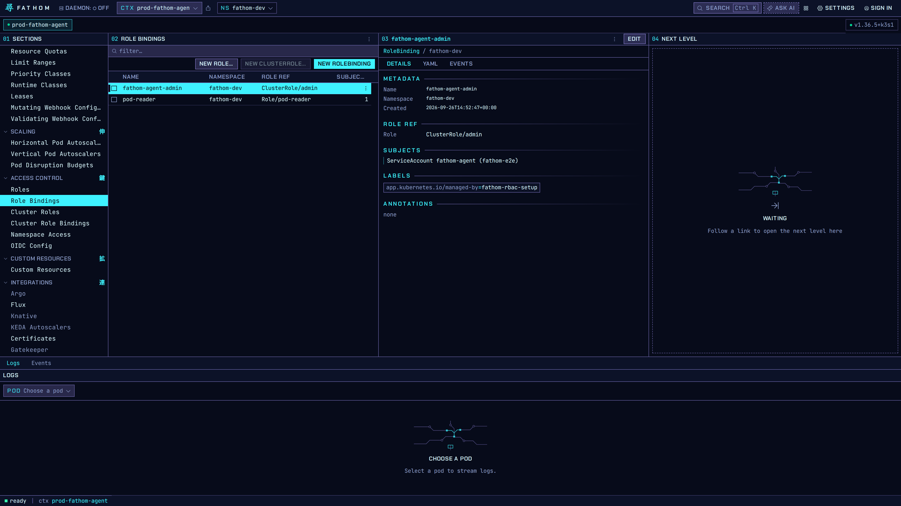
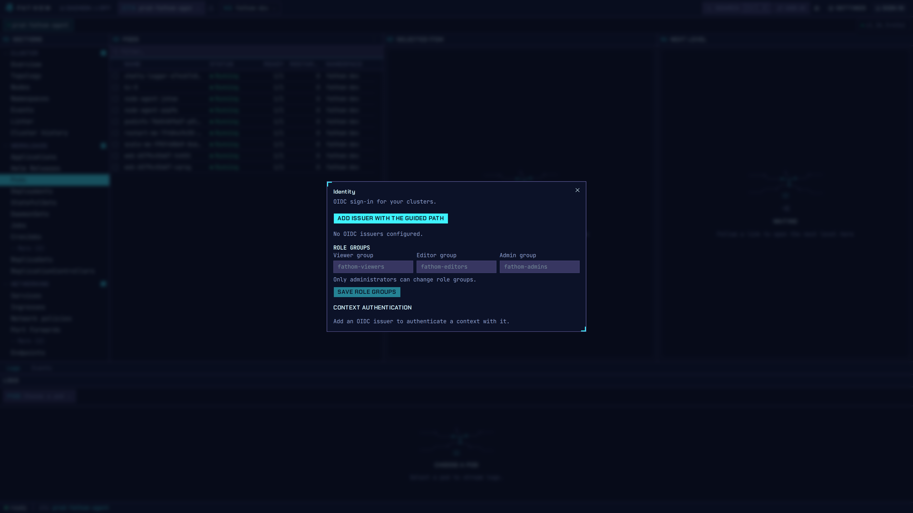

# Access control

## Browse and edit RBAC

**Access control** lists Roles, RoleBindings, ClusterRoles and ClusterRoleBindings. The inspector
shows what a binding refers to and who it binds. **New Role**, **New ClusterRole** and **New
RoleBinding** open a rules editor with presets. Every change is confirmed and audited.

**Namespace Access** shows the access granted in one namespace, and links to creating a role there.

## Sign in with OIDC

**Settings → Sign-in** connects a cluster to an OIDC issuer (Dex, Keycloak, Rauthy, Okta and so
on). **Add issuer with the guided path** walks through it and shows every object it would create
before it writes anything.

**Role groups** map three of your IdP's groups to viewer, editor and admin. Only administrators can
change them.
