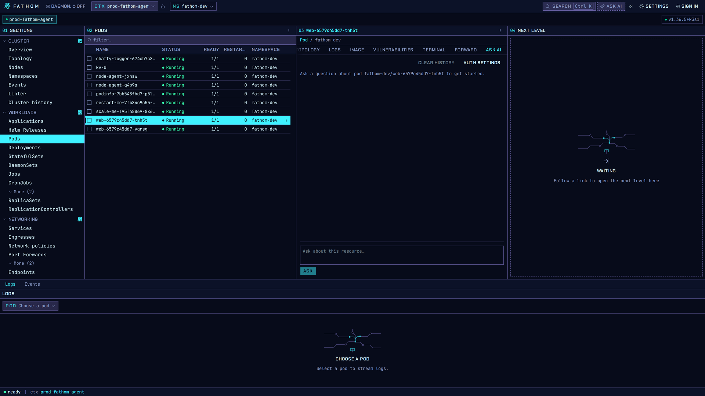
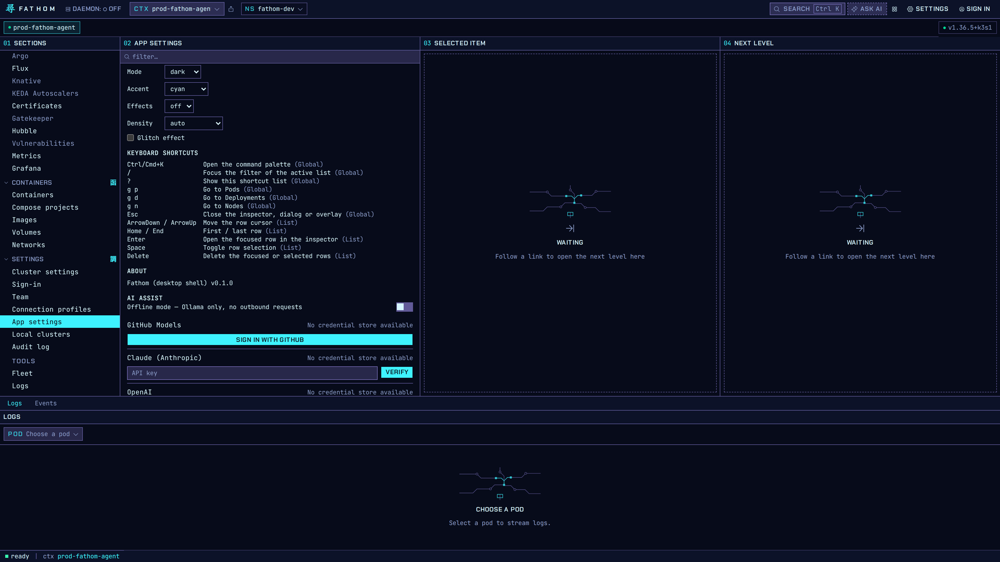

# AI Assist

AI Assist is optional and off until you configure a provider. It is experimental in 0.1.0.

## Ask about a resource

Open any object and choose the **Ask AI** tab, or press **Ask AI** in the top bar. The question is
asked with that object as context: its spec, status and recent events. **Clear history** starts
over, and **Auth settings** jumps to the provider setup.

## Choose a provider

In **Settings → App settings → AI Assist**:

- **GitHub Models**: sign in with GitHub. No key to copy.
- **Claude (Anthropic)** or **OpenAI**: paste an API key and press **Verify**.
- **Ollama**: run a model locally. Fathom checks for a running Ollama and lets you pick its
  endpoint and model.
- **Offline mode**: allows Ollama only and blocks every outbound request.

Keys and tokens are stored in your operating system's credential store (Secret Service on Linux),
never in Fathom's config files. If the app can't reach a credential store, it says **No credential
store available** and won't save a key.

## MCP server

Fathom also includes a Model Context Protocol server, so an AI agent you already use can read your
cluster through Fathom. It is off by default. Writes (scale, replace, delete) need a confirmation.
See [MCP architecture](../mcp/MCP_ARCHITECTURE.md).
