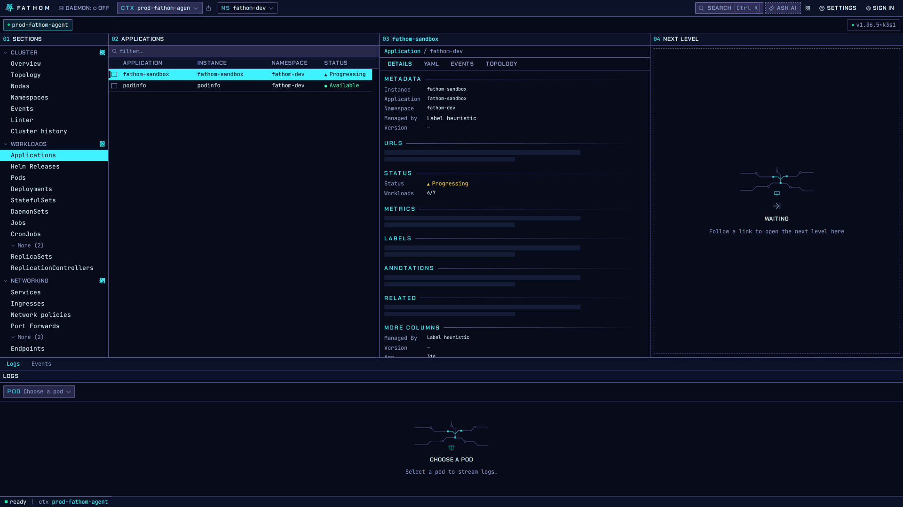
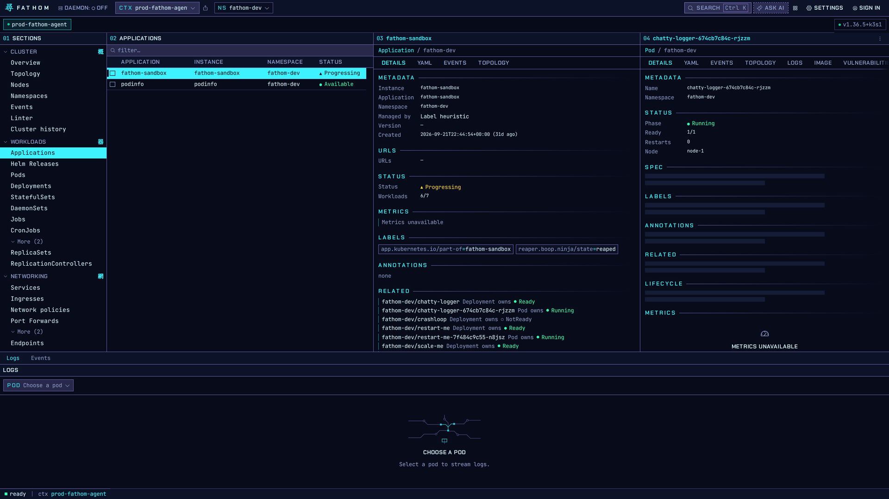

# Applications

Kubernetes has no "application" object, so **Workloads → Applications** builds one from your
Deployments, StatefulSets and DaemonSets. It uses the first of these that applies:

1. Flux ownership labels (the Kustomization or HelmRelease that applied the workload),
2. Helm's release annotations,
3. the standard `app.kubernetes.io/part-of` and `app.kubernetes.io/name` labels.

The inspector shows which rule grouped an application (**Managed by**), so the grouping is never a
mystery.

The status column rolls up the workloads: an application is **Progressing** while any of its
workloads isn't ready yet. In the screenshot, 6 of 7 are ready because one is scaled to zero.

## Drill down

The **Related** block lists every object in the application with its own status. Click one and it
opens in the next column, so you can go from "this app is degraded" to "this pod is the one" in two
clicks.

## Helm releases

**Workloads → Helm Releases** lists releases with their chart, version and status. From a release
you can roll back, upgrade or uninstall, each behind a confirmation. Helm stores releases as
Secrets, so your identity needs `list secrets` in a namespace to see the releases in it.
