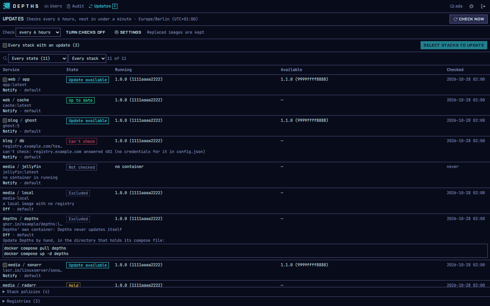
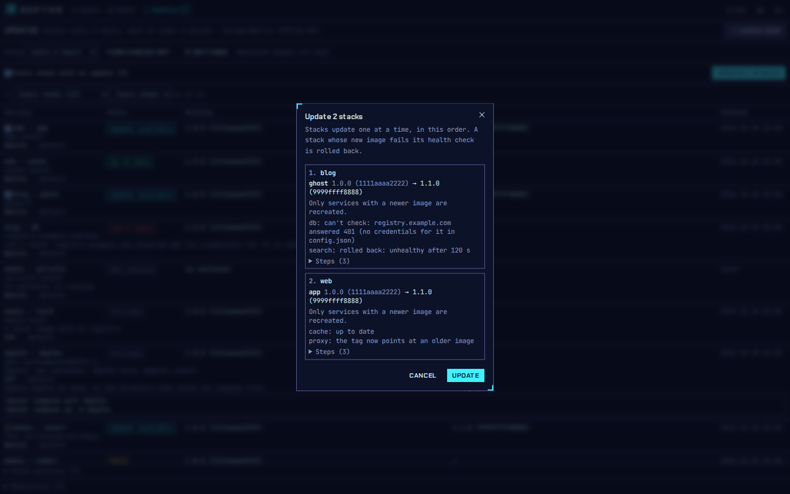
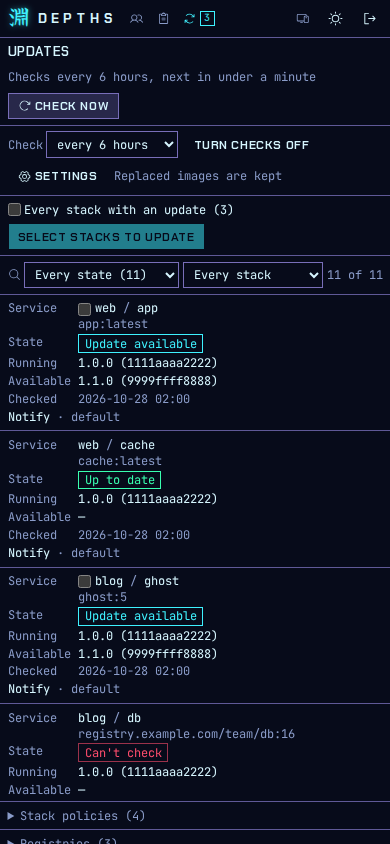
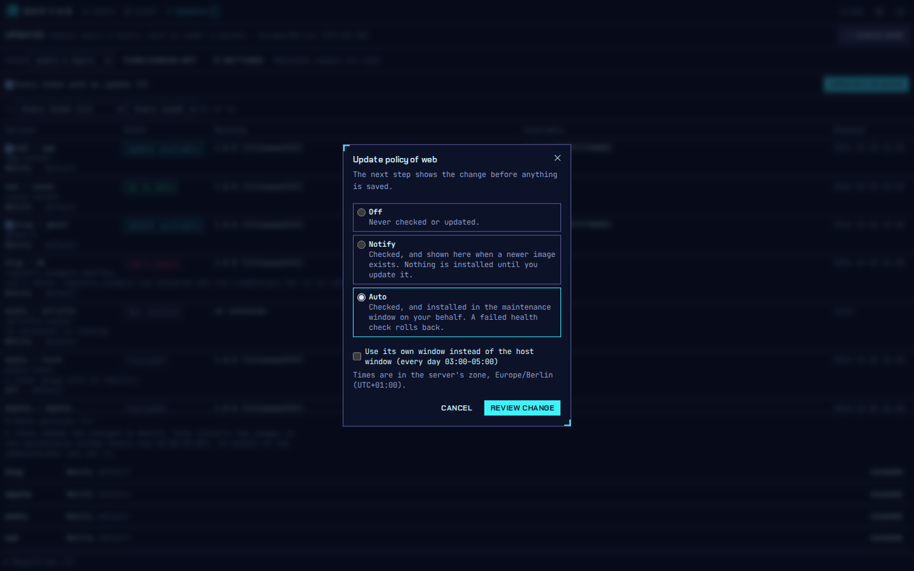
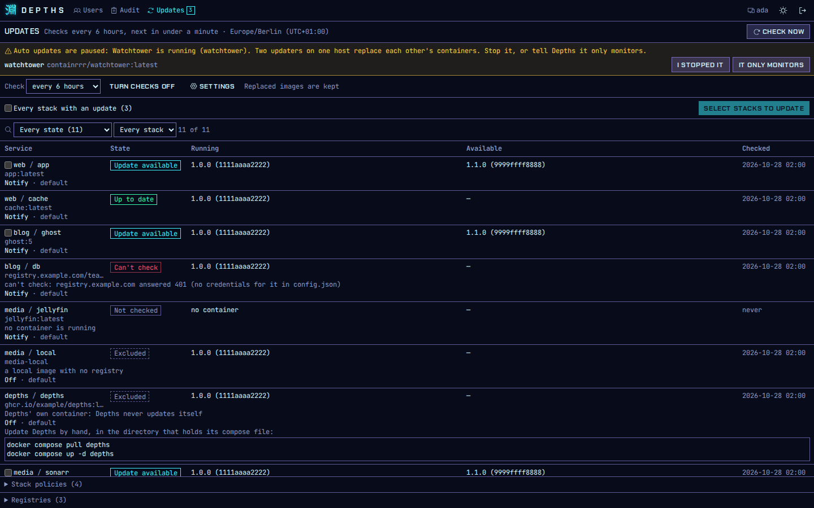

# Image updates

Depths can tell you which services run an image older than the one their tag points to now, on
every stack at once, so you don't have to press Pull on each stack to find out. You can then update
many stacks in one reviewed step, or let chosen stacks update themselves in a maintenance window.

Checking only reads: Depths asks each image's registry what the tag points to and compares that
with what the container runs. A check never pulls an image or restarts a container. Only an update
does that, and only after a person confirmed it or an admin set the stack to update on its own.

## Who sees what

- **Admins** get the **Updates** page in the top bar. The number next to it is how many stacks
  have at least one service with an update.
- **Users** see the update state of each service on the pages of the stacks assigned to them.
  They don't get the Updates page or the count.

The whole feature can be removed with `DEPTHS_UPDATES=off` (see
[All settings](install.md#all-settings)). Then there is no Updates page and Depths never talks to
a registry.

## Turning checks on

Checks start **off**. Until an admin turns them on, Depths asks no registry anything, and the
Updates page says so.

1. Open **Updates**.
2. Pick how often to check (every hour, 6 hours, 12 hours or day).
3. Choose **Turn checks on**, read the summary of the change, and choose **Confirm**.

The change is recorded in the audit log. From then on Depths checks on that schedule; the header
shows the interval, when the next check is due, and the host's time zone. You can change the
interval or turn checks off from the same page.

**Check now** checks every image straight away. If a check is already running, Depths says how
long to wait before asking again.

Changing the settings and **Check now** need a trusted network. From an untrusted one you can
still read the page (see [Networks and the restricted view](security.md)).

## What each state means



| State | Meaning |
|---|---|
| Update available | The tag now points to a different image than the one running. The page shows the running and the new version (or digest) |
| Up to date | The container runs what the tag points to |
| Not checked | Not checked yet, or no container is running for the service |
| Can't check | The registry could not be asked. The reason names it: no credentials, a credential helper, a rate limit, or the registry being unreachable |
| Excluded | Depths never checks this service. The reason says why: pinned by digest, built locally, a local image, a Watchtower label, or Depths' own container |
| Tag moved back | The tag points to an image older than the running one. Never applied on its own |
| Held | An update stopped before anything changed, because the new image would run as root, or the compose file has an escape finding. See [Holds](#holds) |
| Rejected | This image was rolled back before. It is not tried again until a newer image appears or an admin chooses **Retry** |
| Updating | An update of this service is running |
| Rolled back | The new image was unhealthy, and Depths went back to the old one |
| Rollback failed | The new image was unhealthy, and going back failed too. The stack needs a person |
| Failed | The update stopped with an error before the new container ran. The old container keeps running |
| Interrupted | Depths restarted in the middle of an update. The row shows what is really running |

Filter the list by state or by stack. Every row links to its stack.

## Updating stacks

1. On **Updates**, tick the stacks to update, or open one stack's row.
2. Choose **Update**. Depths shows a preview per stack: each service that would be recreated, its
   old and new image, and anything that would stop it (a hold, a compose finding, a service that
   is excluded).
3. Choose **Confirm**. Depending on how long ago you signed in, Depths asks for your passkey first.

Updating needs an admin, a trusted network and a passkey. Each stack is audited as its own entry,
with the services, the old and new image, and the outcome.



|  |
|---|

For each stack, one after the other, Depths:

1. pulls the new image **by digest**, the exact image the preview showed, never "whatever the tag
   says now";
2. runs the [hold checks](#holds) against it;
3. keeps the running image under a local tag (see [Keep tags](#keep-tags)), then points the
   compose file's tag at the new image;
4. recreates **only** the services that have a new image (`docker compose up -d --no-deps`).
   Other services of the stack keep running untouched;
5. waits for the new containers to be healthy, up to the health timeout (2 minutes by default;
   30 seconds to 30 minutes, under **Settings**). A service without a healthcheck must keep
   running for that long.

The compose file is never edited. If a stack changed since the preview, its update is refused as
stale and you preview again. While one stack updates, its other operations wait.

Updates run on the server: you can close the browser and come back to the outcome on the Updates
page and in the audit log.

### Holds

A hold stops an update after the pull and before anything on the host changes. The tag, the
containers and the compose file stay as they were. Two things hold an update:

- **The image now runs as root.** The running container runs as a non-root user and the new image
  runs as root. A service whose compose file sets `user:` is never held, because that user wins.
  On a rootless daemon, or one that remaps users, the change is shown but not held.
- **The compose file has an escape finding** (see [Compose lint](security.md#compose-lint)). With
  `DEPTHS_COMPOSE_POLICY=enforce` the update is refused. With `warn`, your confirm must acknowledge
  the finding, and an unattended update holds.

A held image is kept under the tag `depths-keep/<stack>:<service>-held`, so you can inspect it
with `docker image inspect`. To run it anyway, choose **Apply held** on the row: it needs a
passkey and is audited as a held image applied.

### Rollback

If a new container isn't healthy within the health timeout, Depths points the tag back at the
image it kept, recreates the service on it, and marks the new image **Rejected**. The update is
audited as rolled back. The rejected image is not tried again, by hand or on a schedule, until the
tag points to a newer image or an admin chooses **Retry** on the row (audited).

A rollback puts back the image, not the data. If the new version migrated a database or changed
files in a volume, the old version runs against the changed data. Keep stacks like that on
**Notify** and update them by hand, with a backup.

### Stacks that share a tag

A tag belongs to the whole host, not to one stack. If two stacks use `nginx:1.27` and one of them
rolls back, the tag points at the old image again. The other stack keeps running the new image,
shows **Update available** again, and would get the old image the next time it is recreated.
`docker compose pull` has the same exposure today. Depths documents it rather than preventing it.

## Unattended updates

Each stack has a policy:



| Policy | What Depths does |
|---|---|
| Off | Doesn't check the stack |
| Notify (default) | Checks and shows updates. A person updates |
| Auto | Checks, and updates the stack on its own in the maintenance window |

Set a stack's policy from its row on **Updates**. Changing a policy, the window, the scope,
label-only mode or cleanup needs an admin, a trusted network and a passkey, and is audited with the
value before and after. Watchtower labels can only make a service's policy stricter (see
[Migrating from Watchtower](migrating-from-watchtower.md)).

### Maintenance window

Auto updates only start inside the maintenance window: every day, 03:00 to 05:00 by default. Pick
the days and times under **Settings**. A stack can have its own window, which replaces the host's.
A window may cross midnight (22:00 to 02:00).

The window is in the host's local time, which Depths reads from `/etc/localtime` (mount it
read-only, see [Installing Depths](install.md)). Without it, windows are in UTC, and the header
says so. Each stack runs at most once per window. A daylight-saving change neither runs a stack
twice nor skips a day.

When a window opens, Depths updates the due stacks one after the other. If the window closes while
it works, the stacks not yet started wait for the next window. The header shows when the next
window opens.

### Who authorised it

An unattended update has no signed-in person, so it can't check a network or ask for a passkey.
It is authorised by the policy change that set the stack to **Auto**, which needed both. It is
audited as "Depths (scheduled)", together with the admin who set the policy.

If that admin is no longer an admin, the stack's Auto policy is **paused** and listed as such on
the Updates page. It runs again once another admin sets the stack to Auto again.

### When Auto is paused

The header says when no Auto update runs, and why:

- `DEPTHS_UPDATES_AUTO=off` is set (every policy stays as it is; checks go on);
- `updates.json` in the data directory can't be read. Fix or remove the file;
- a Watchtower container is running on the host, and no admin has answered for it (see
  [Migrating from Watchtower](migrating-from-watchtower.md)).

## Keep tags

Before every update, Depths tags the running image as `depths-keep/<stack>:<service>-previous`.
A held image gets `depths-keep/<stack>:<service>-held`. These are ordinary local tags: you see them
in `docker images`.

They are Depths' way back. A tagged image survives `docker image prune` and other tools' cleanup,
so a rollback never needs a download, and an image that was rolled back away from can still be
inspected. Each update of a service moves its `-previous` tag to the image it replaces, so there is
one per service.

Removing a keep tag by hand removes the way back for that service. If you delete a stack, its keep
tags stay until you remove them: `docker image rm depths-keep/<stack>:<service>-previous`.

## Cleaning up old images

Every update leaves the replaced image on disk. With **Remove old images** on (off by default,
under **Settings**), a successful update removes the image that was the service's previous image
before this update, that is, the image from two updates ago. Depths never removes:

- the service's previous image (its rollback target);
- an image any container still uses, on any stack or none;
- an image Depths didn't record as a previous image itself.

Removal is `docker image rm`, never forced and never a prune. Each removal is audited. An image
that can't be removed (because something uses it) is kept and noted.

## Watchtower

Depths honours the Watchtower labels your services already carry, and pauses its own Auto updates
while a Watchtower container runs. See [Migrating from Watchtower](migrating-from-watchtower.md).



## Depths' own container

Depths never updates itself, because recreating its own container would cut the update off. Its
row shows whether a newer image exists, and the commands to run by hand in the directory that
holds its compose file:

```sh
docker compose pull depths
docker compose up -d depths
```

## Private registries

Images on a private registry need a `config.json` with credentials mounted into Depths. Until
then, those services show **Can't check**. The steps are in
[Installing Depths](install.md#private-registries).

At the bottom of the Updates page, **Registries** lists every registry Depths has talked to, how
it authenticates to each (anonymously, or with credentials from `config.json`), and whether a
registry is being given a rest after a rate limit or an error. Depths never shows or stores the
credentials themselves.
