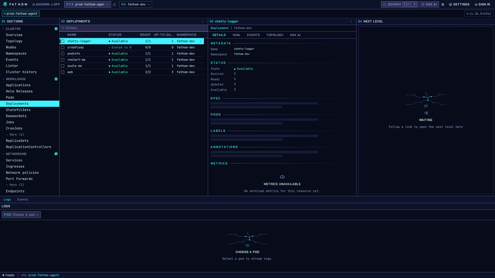
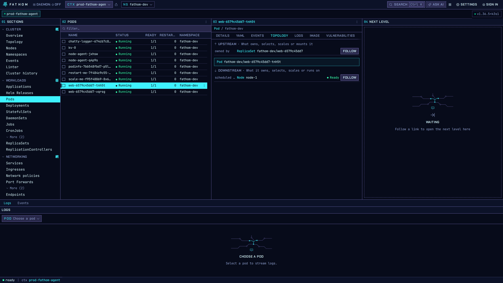
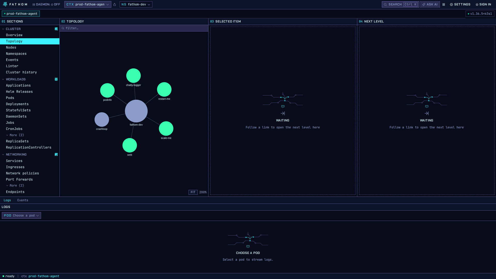
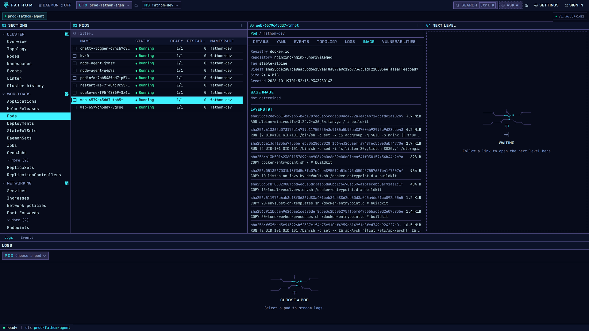

# Inspecting resources

## The inspector

Open any row (click it, or move to it with the arrow keys and press `Enter`) and the inspector
shows it. Tabs depend on the kind. A pod has:

| Tab | Shows |
|---|---|
| Details | Metadata, status, spec summary, labels, annotations, related objects, lifecycle, metrics |
| YAML | The live object; edit, diff and apply it after a confirmation |
| Events | Events for this object |
| Topology | What owns it, and what it owns, selects, scales, mounts or runs on |
| Logs | Streaming logs for its containers |
| Image | Registry, tag, digest and the layer history of each container image |
| Vulnerabilities | Trivy Operator findings, when Trivy is installed |
| Ask AI | A question box about this object (see [AI Assist](ai-assist.md)) |

Metrics need Prometheus or metrics-server. Without them the Metrics block says so instead of
showing empty charts.

## Following links: the cascade

Links in the inspector (an owner, a node, a related pod) open in the **Next level** column. Your
list and the object you came from stay where they are, so you can compare the two side by side.
Press `Esc` to close the inspector.

## Topology for one object

The inspector's Topology tab shows the chain upstream (what owns, selects or scales the object) and
downstream (what it owns or runs on). **Follow** opens that neighbour in the next column.

## Topology for a namespace

**Cluster → Topology** draws the namespace as a graph: the namespace in the middle, its workloads
around it. Green nodes are healthy, grey ones are scaled to zero or not ready. **Fit** resets the
zoom.

## What's in an image

The Image tab reads the image's manifest and config from its registry and lists every layer with
its size and the build command that made it. You can see what a container runs without pulling
the image yourself.
