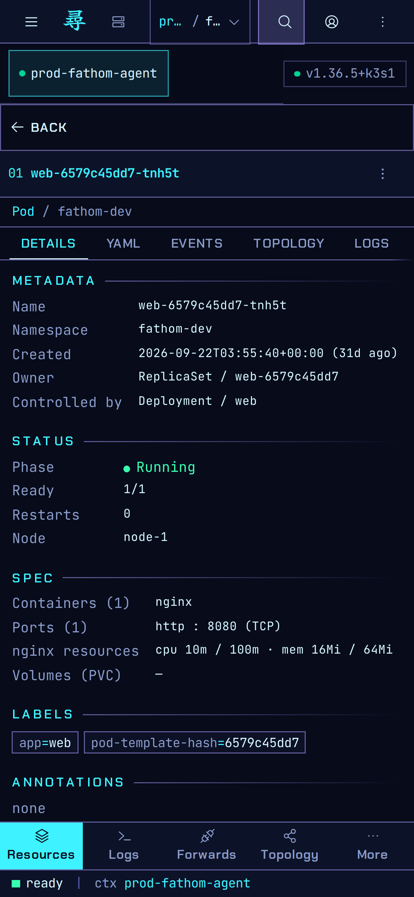
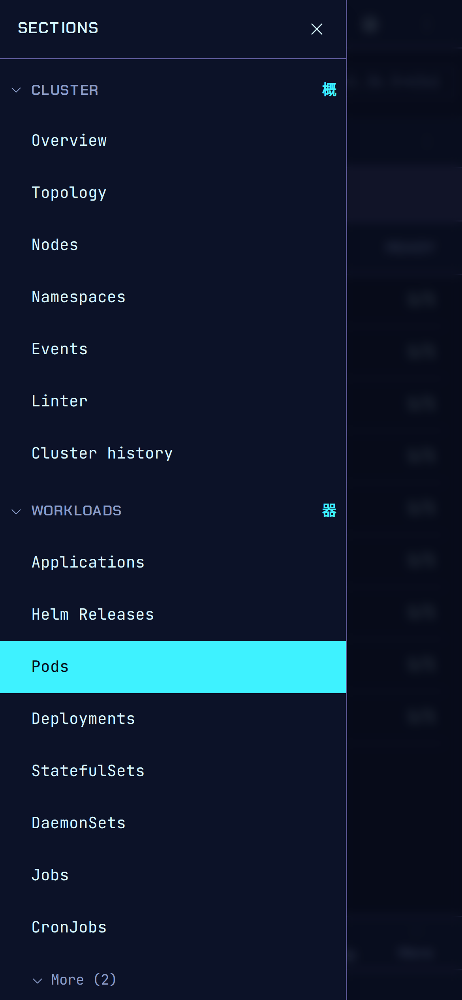
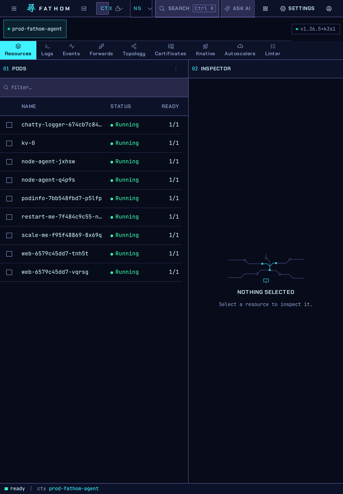

# Phone and tablet

Fathom's layout adapts to the window size, from an ultrawide monitor down to a phone held in
portrait. This matters most in [hosted mode](../HOSTED.md), where you open Fathom in a browser.

| Phone: list | Phone: inspector | Phone: sections |
|---|---|---|
|  |  |  |

On a phone:

- One column at a time: the list, then the inspector. **Back** returns to the list.
- The bar along the bottom switches between Resources, Logs, Forwards, Topology and More.
- The menu button at the top left opens the sections drawer.

On a tablet, the list and the inspector sit side by side:

