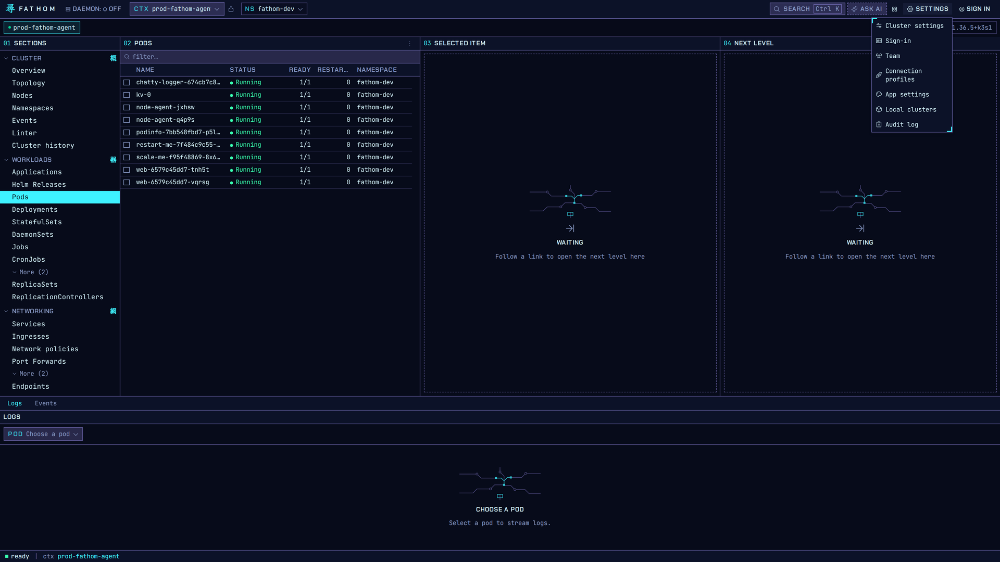
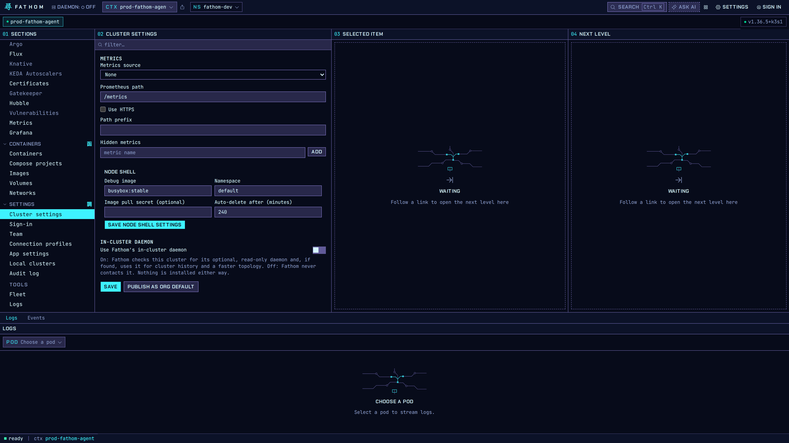
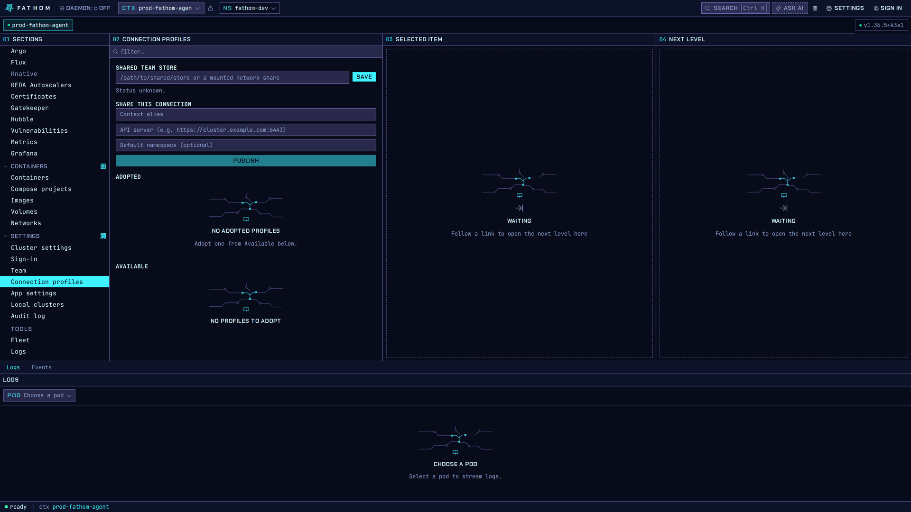

# Settings and teams

**Settings** in the top bar opens:

| Item | What it's for |
|---|---|
| Cluster settings | Metrics source, Node Shell defaults, the in-cluster daemon (per cluster) |
| Sign-in | OIDC issuers and role groups (see [Access control](access-control.md)) |
| Team | Teams from your identity provider |
| Connection profiles | Share a cluster connection with your team, or adopt one |
| App settings | Theme, density, keyboard shortcuts, AI Assist |
| Local clusters | Create and remove kind clusters on this machine |
| Audit log | Every write Fathom made, with who, what and when |

## Cluster settings

These settings are saved per cluster:

- **Metrics**: choose Prometheus or metrics-server, the Prometheus path, and metrics to hide.
  Fathom reaches Prometheus through the API server proxy, so nothing needs to be exposed.
- **Node Shell**: the debug image, the namespace it runs in, an optional image pull secret, and how
  long before the debug pod is deleted automatically.
- **In-cluster daemon**: when this is on, Fathom checks the cluster for its optional, read-only
  daemon and, if it finds one, uses it for cluster history and a faster topology. Fathom never
  installs anything.

An administrator can **Publish as org default** to give the whole team the same settings.

## Connection profiles

Point **Shared team store** at a folder your team shares (a mounted network share, for example).
**Share this connection** publishes a cluster's alias, API server and default namespace there.
Teammates see it under **Available** and adopt it in one click. Profiles never contain credentials.
