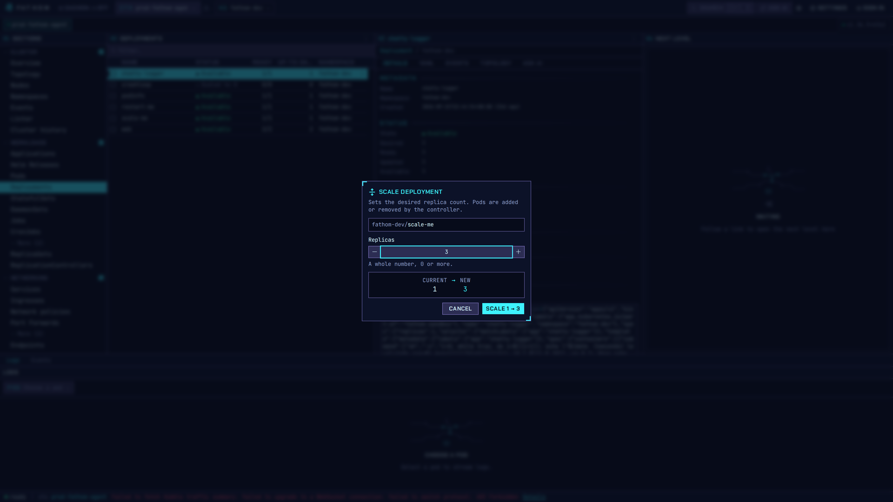
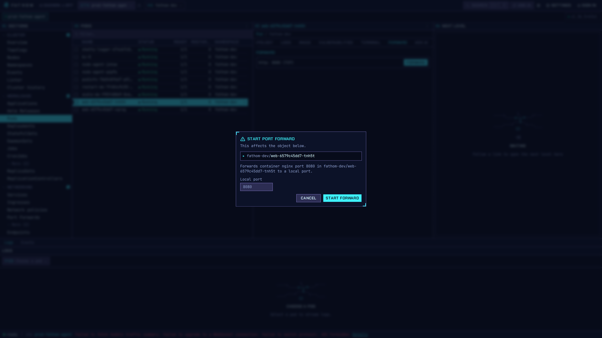

# Workloads: logs, scale, port forwards

## Tail logs

Open a pod and choose the **Logs** tab, or pick a pod in the dock at the bottom of the window. Logs
stream live, and you can pause and resume them or switch containers. Your place in the list stays
put while you read.

## Scale

Deployments, StatefulSets and ReplicaSets can be scaled from the row menu or the inspector. The
dialog shows the current and the new replica count before anything changes. Restart and delete
work the same way: every write is confirmed first, and recorded in the local audit log
(**Settings → Audit log**).

## Port forward

Start a forward from a pod or a service. The dialog names the container port and the object, and
lets you pick the local port. Running forwards are listed under **Networking → Port Forwards**. They
survive a restart of the app until you stop them.

## Other workload actions

- **Exec** into a container, after a confirmation and an RBAC check.
- **Debug containers**: attach an ephemeral container to a running pod.
- **Node Shell**: a privileged debug pod on a node, created after a confirmation and cleaned up
  automatically. Its image and namespace are set in [cluster settings](settings-and-teams.md).
- **Nodes**: cordon, uncordon, drain and taint.
